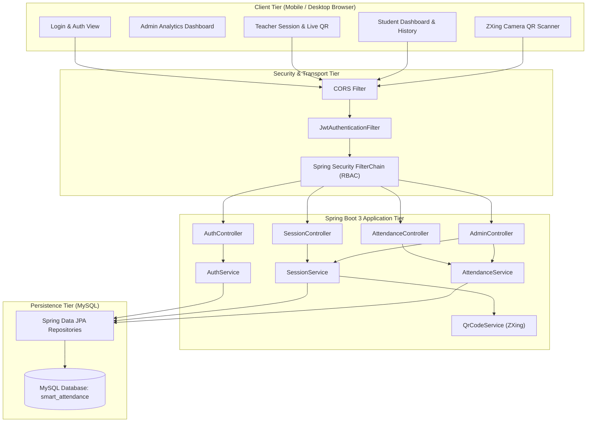
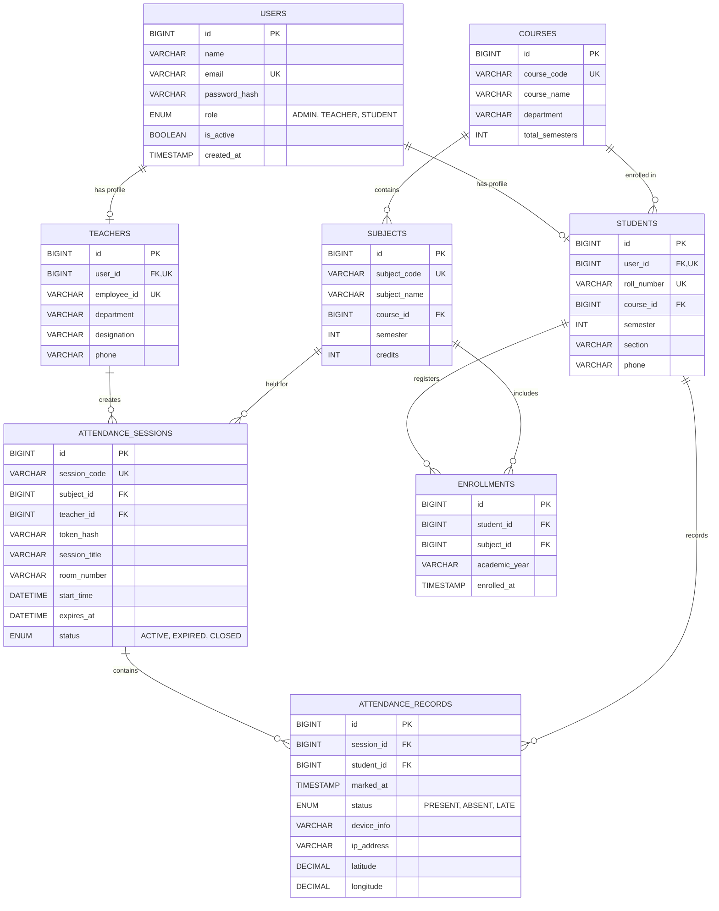
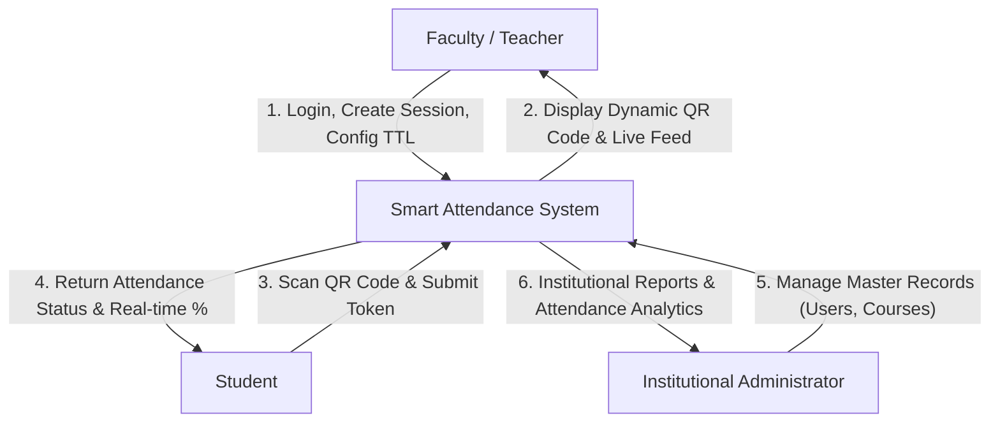
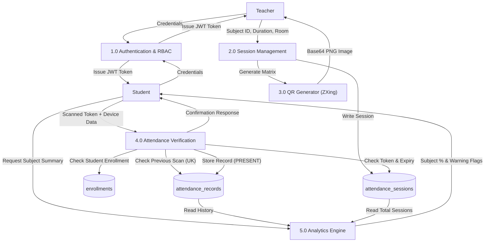

# MCA Master Project Report & Technical Specification
## QR-Based Smart Attendance Management System
**Academic Year:** 2026–2027  
**Technology Stack:** React.js, Java Spring Boot 3, MySQL, HTML5, CSS3, JavaScript (ES6+), ZXing  

---

## 1. Abstract
Attendance tracking in educational institutions and corporate training environments is a mandatory operational requirement for compliance, grading, and academic eligibility. Traditional approaches rely on paper roll-call registers or manual signatures, which waste 10–15 minutes of instructional lecture time per hour, are susceptible to buddy-punching (proxy attendance), and introduce high transcription error rates.

This project delivers a **QR-Based Smart Attendance System** engineered with a **React.js Single Page Application (SPA)** frontend, a **Java Spring Boot 3 RESTful micro-service** backend, and a **MySQL Relational Database**. The system enables faculty members to generate time-bound, cryptographically random, rolling QR codes displayed in the classroom. Students authenticate through their mobile browser, scan the projected QR code, and mark their attendance. The backend implements atomic transactions with database-level uniqueness constraints `(session_id, student_id)`, dynamic TTL expiration, and enrollment verification to prevent duplicates and eliminate attendance fraud.

---

## 2. Problem Statement & Objectives

### 2.1 Problem Statement
- **Time Inefficiency:** Manual calling of 60+ student names consumes 15–20% of class duration.
- **Proxy Attendance (Buddy Punching):** Students sign paper sheets for absent peers or mark attendance without physical presence.
- **Data Fragmentation & Errors:** Paper logs are vulnerable to damage, loss, illegible handwriting, and inaccurate manual percentage calculations.
- **Delayed Visibility:** Students only discover they are below the mandatory 75% attendance threshold at the end of the semester when exam hall tickets are blocked.

### 2.2 System Objectives
1. **Automate Attendance:** Reduce check-in latency to under 3 seconds per student.
2. **Eliminate Duplicate & Proxy Records:** Guarantee single-scan per student per session via MySQL `UNIQUE(session_id, student_id)` and rotating QR tokens.
3. **Dynamic Session Expiry:** Enforce strict time-to-live (TTL) of 1–10 minutes per attendance session.
4. **Real-Time Analytics:** Automatically compute subject-wise percentages `(Attended / Total * 100)` and flag low attendance (< 75%) with warning badges.
5. **Role-Based Access Control (RBAC):** Distinct interfaces and API authorization for `ADMIN`, `TEACHER`, and `STUDENT`.

---

## 3. Technology Stack Justification

| Technology | Layer | Role in Project | Technical Justification |
| :--- | :--- | :--- | :--- |
| **React 18** | Frontend UI | Single Page Application (SPA) | Component reusability, virtual DOM performance, reactive state updates. |
| **HTML5 / CSS3 / JS** | Frontend Core | Structure & Styling | Modern CSS grid, flexbox, glassmorphic UI, responsive mobile compatibility. |
| **@zxing/browser** | Frontend Scanner | Client-side camera QR decoding | Real-time QR frame decoding directly in browser without server roundtrip. |
| **Java 17+ / Spring Boot 3** | Backend Core | RESTful Microservice | Enterprise robustness, dependency injection, type safety, multi-threading. |
| **Spring Security & JJWT** | Security | Authentication & Authorization | Stateless JWT bearer tokens, BCrypt password hashing, RBAC filter chain. |
| **Spring Data JPA / Hibernate**| ORM | Data Persistence | Object-Relational Mapping, query abstraction, automated schema creation. |
| **ZXing (Zebra Crossing)** | Backend QR Engine | QR Generation | High-speed, high-density matrix barcode generation into Base64 PNG. |
| **MySQL 8+** | Database | Relational Storage | ACID compliance, referential integrity, unique constraints, transactional safety. |

---

## 4. System Architecture

---

## 5. Entity-Relationship (ER) Diagram

---

## 6. Data Flow Diagrams (DFD)

### 6.1 DFD Level 0 (Context Diagram)

### 6.2 DFD Level 1 (Detailed Subsystem Data Flow)

---

## 7. Anti-Proxy Security Strategy

| Threat Vector | Attack Scenario | Implemented Defense Mechanism |
| :--- | :--- | :--- |
| **Duplicate Check-in** | Student clicks "Scan" multiple times rapidly or submits multiple HTTP requests. | **MySQL Unique Constraint:** `UNIQUE(session_id, student_id)`. The secondary insert fails with HTTP 409 Conflict. |
| **Remote Photo Sharing** | Student inside class snaps photo of QR and sends it to an absent friend via WhatsApp. | **1. Short Dynamic TTL:** Session expires in 2–5 minutes. **2. Rolling QR:** Teacher clicks "Rotate Token" which invalidates the old token every 20 seconds. |
| **Unenrolled Access** | Student from a different branch or semester scans QR to gain attendance. | **Enrollment Validation:** Backend joins `enrollments` table verifying `student_id` is registered for `subject_id`. |
| **Token Guessing / Brute Force**| Student writes a script to guess tokens. | Cryptographically strong 128-bit UUID (`UUID.randomUUID()`) having $3.4 \times 10^{38}$ possible values. |
| **API Impersonation** | Student crafts raw POST requests using curl or Postman without logging in. | **Spring Security Stateless JWT:** Authorization header validated on each request; student identity extracted directly from verified JWT claims. |

---

## 8. Mathematical Attendance Percentage Formulation

For any student $i$ enrolled in subject $j$:
$$\text{Attendance Percentage } (P_{i,j}) = \left( \frac{\sum \text{Attended Sessions}_{i,j}}{\text{Total Sessions Held}_j} \right) \times 100$$

### University Criteria Condition:
$$\text{Eligibility Status} = \begin{cases} 
\text{ELIGIBLE (Good)}, & \text{if } P_{i,j} \ge 85\% \\ 
\text{WARNING (Borderline)}, & \text{if } 75\% \le P_{i,j} < 85\% \\ 
\text{DEBARRED (Critical Shortage)}, & \text{if } P_{i,j} < 75\% 
\end{cases}$$

---

## 9. Comprehensive Viva Voce Questions & High-Scoring Answers

### Q1: What makes your attendance system "Smart" compared to biometric thumb scanners?
**Answer:** Biometric thumb scanners create physical bottlenecks at classroom doorways (60 students taking 10 seconds each = 10 minutes delay) and suffer hardware degradation. Our Smart Attendance system is decentralized: the teacher displays one screen, and 60+ students scan concurrently on their own devices within seconds without physical contact or specialized hardware.

### Q2: How does the system prevent a student from marking attendance twice?
**Answer:** We enforce duplicate prevention across two layers:
1. **Application Layer:** `attendanceRecordRepository.existsBySessionIdAndStudentId(...)` checks prior to insertion.
2. **Database Engine Layer:** `UNIQUE KEY uk_session_student (session_id, student_id)` on the `attendance_records` table. Even if two concurrent multi-threaded requests arrive in the exact same millisecond, MySQL serializes the transaction and throws a `DataIntegrityViolationException`, which our `GlobalExceptionHandler` converts into an informative HTTP 409 response.

### Q3: How do you prevent a student in the classroom from sending a picture of the QR code to an absent friend?
**Answer:** We mitigate this through:
1. **Short TTL:** Sessions are configured with short countdowns (e.g., 2 minutes).
2. **Dynamic Rolling QR (Token Rotation):** The teacher interface allows 20-second rolling token updates; when refreshed, the previous token hash is replaced in the database. A forwarded screenshot taken 30 seconds ago is immediately rejected as invalid.
3. **Audit Fields:** We record client IP, browser user-agent, and optional geolocation coordinates.

### Q4: Why did you choose JWT over HTTP Session cookies?
**Answer:** HTTP Sessions store state in server RAM, making horizontal scaling difficult. JSON Web Tokens (JWT) are stateless: all authentication claims and signatures reside in the token carried by the client. The backend verifies the HMAC-SHA256 signature using `io.jsonwebtoken` without querying session storage, reducing server memory usage to zero.

### Q5: How does the camera scan work in the browser without an external app?
**Answer:** The frontend uses HTML5 `navigator.mediaDevices.getUserMedia` wrapped by the `@zxing/browser` library (`BrowserQRCodeReader`). It accesses the device's back camera stream directly in the DOM, processes video frames onto an HTML5 canvas, and extracts the QR matrix payload using computer vision algorithms in real time.

---

## 10. Test Scenarios & Results

| Test Case ID | Test Scenario | Input Data | Expected Result | Actual Result | Status |
| :--- | :--- | :--- | :--- | :--- | :--- |
| **TC-01** | Valid Student Scan | Active QR token, enrolled student | HTTP 200, Status: PRESENT, count increments | Attendance recorded instantly | **PASS** |
| **TC-02** | Duplicate Scan | Re-scanning same token for same student | HTTP 409 Conflict, "Attendance already recorded" | Duplicate blocked | **PASS** |
| **TC-03** | Expired QR Token | Scanning token after TTL timer expires | HTTP 400 Bad Request, "Session has expired" | Scan rejected | **PASS** |
| **TC-04** | Unenrolled Student | Student not enrolled in subject scans code | HTTP 403 Forbidden, "Not enrolled in subject" | Scan rejected | **PASS** |
| **TC-05** | Unauthorized API Access | Student attempts to call `/api/sessions` (teacher API) | HTTP 403 Forbidden | Access denied | **PASS** |
| **TC-06** | Manual Token Fallback | Typing token string via keyboard | HTTP 200, Status: PRESENT | Attendance marked successfully | **PASS** |
